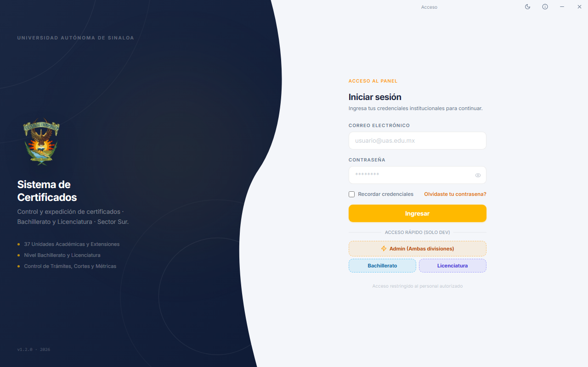
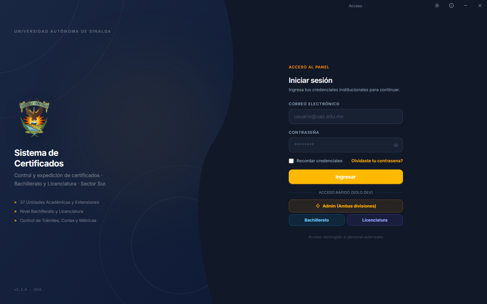
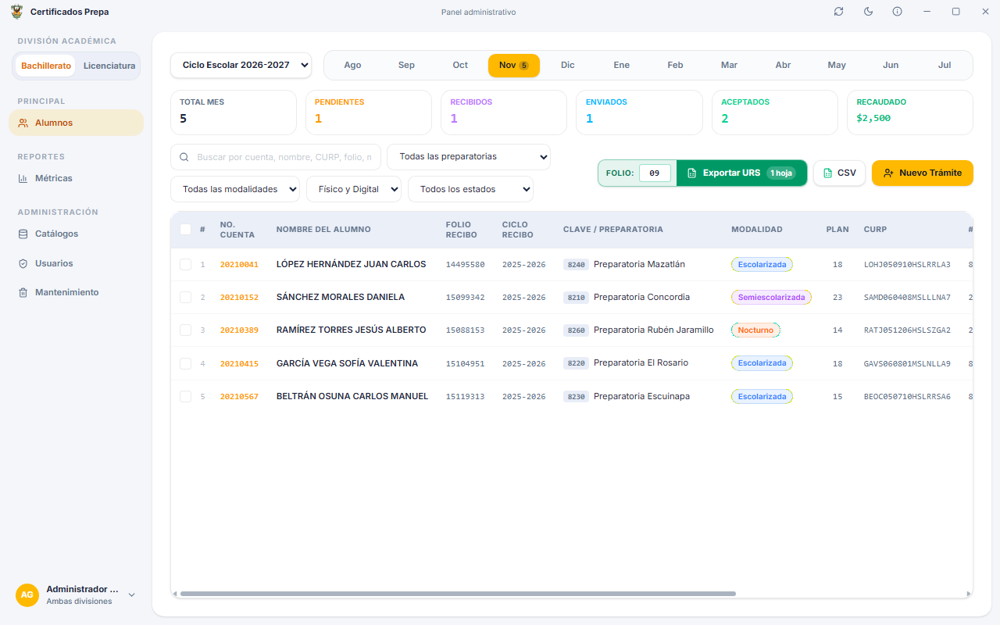
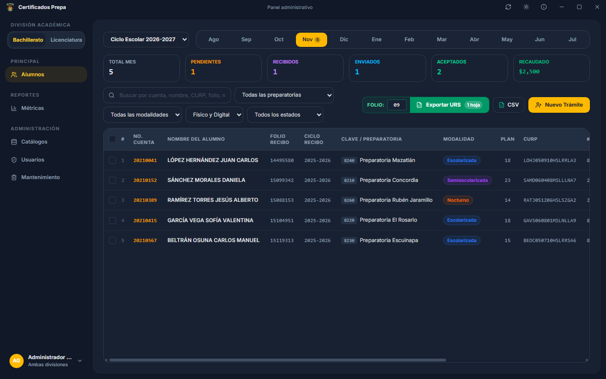
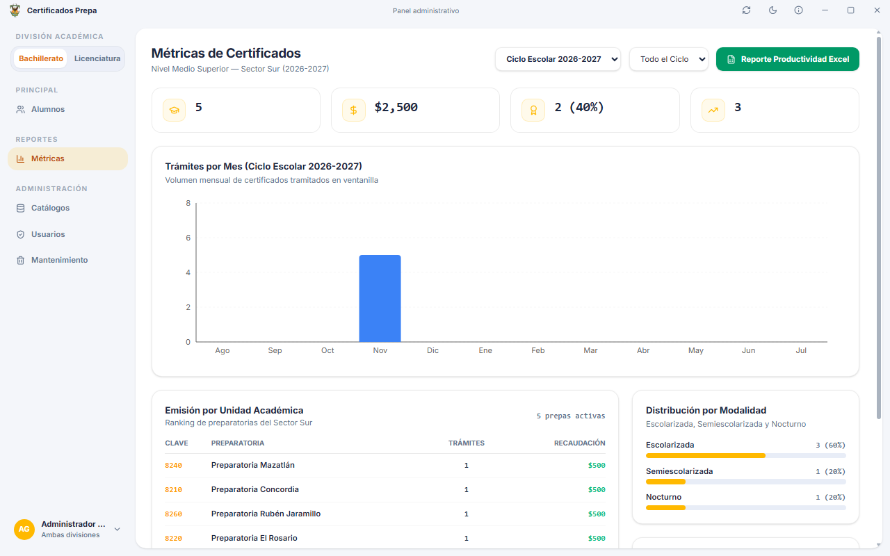
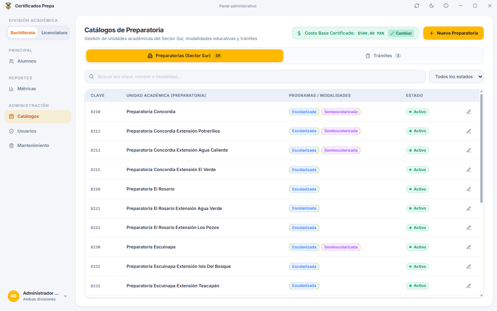
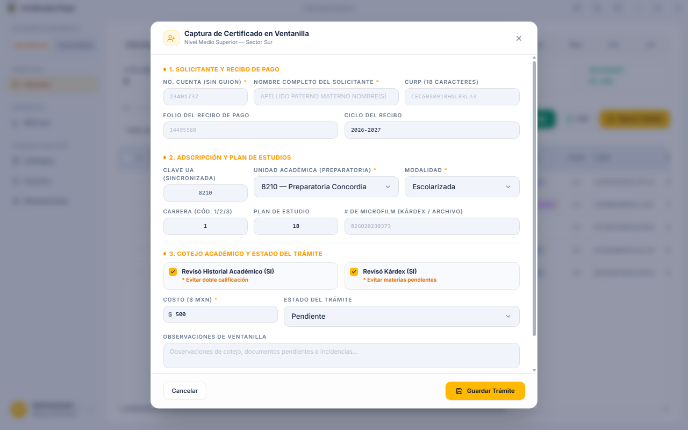

# Guía del Sistema de Diseño (Design System) — Sistema de Certificados y Trámites

> **Universidad Autónoma de Sinaloa (UAS) — Unidad Regional Sur**  
> Documento técnico y visual de referencia sobre la arquitectura de diseño, componentes, tipografía, paleta cromática, patrones de interacción y modo oscuro de la aplicación.

---

## Índice

1. [Filosofía y Principios de Diseño](#1-filosofía-y-principios-de-diseño)
2. [Paleta de Colores y Tokens Semánticos](#2-paleta-de-colores-y-tokens-semánticos)
3. [Tipografía y Jerarquía Visual](#3-tipografía-y-jerarquía-visual)
4. [Organización de la Información y Layout](#4-organización-de-la-información-y-layout)
5. [Distribución y Semántica del Color](#5-distribución-y-semántica-del-color)
6. [Jerarquía y Ubicación de Botones](#6-jerarquía-y-ubicación-de-botones)
7. [Animaciones y Micro-interacciones](#7-animaciones-y-micro-interacciones)
8. [Implementación del Modo Oscuro](#8-implementación-del-modo-oscuro)
9. [Alertas, Notificaciones y Feedback](#9-alertas-notificaciones-y-feedback)
10. [Estados Interactivos (Hovers, Focus y Active)](#10-estados-interactivos-hovers-focus-y-active)
11. [Galería de Pantallas y Casos de Uso](#11-galería-de-pantallas-y-casos-de-uso)

---

## 1. Filosofía y Principios de Diseño

El sistema está concebido para optimizar el trabajo administrativo y de ventanilla en el control escolar de certificados y trámites académicos (tanto para el nivel de **Bachillerato** como para **Licenciatura**).

```
                      PRINCIPIOS RECTORES DE DISEÑO
 ┌──────────────────────┐  ┌──────────────────────┐  ┌──────────────────────┐
 │  Densidad Eficiente  │  │ Identidad Institucional│ │ Ergonomía y Descanso │
 │  Alta visibilidad de │  │  Azul marino águila y │  │  Contraste balanceado│
 │  datos sin saturar   │  │  dorado oficial UAS   │  │  para 8h continuas   │
 └──────────────────────┘  └──────────────────────┘  └──────────────────────┘
```

1. **Densidad Eficiente de Información:** Los operadores manejan cientos de solicitudes por ciclo. La interfaz prioriza tablas compactas pero legibles, numeraciones ordenadas, códigos monoespaciados y filtros instantáneos.
2. **Identidad Institucional UAS:** Incorporación sobria de los colores representativos de la Universidad Autónoma de Sinaloa: **Azul Marino Águila** (`#1a2742`) como tono base de autoridad y **Dorado Universitario** (`#f59e0b` / `#fbbf24`) como llamado a la acción principal.
3. **Ergonomía Visual para Jornadas Completas:** Alternancia fluida entre Modo Claro y Modo Oscuro, evitando fondos blancos puros (se usa `#f4f6fa` para mitigar el destello) y fondos negros planos (se emplea un azul noche profundo `#111827`).
4. **Respuesta Inmediata:** Transiciones menores a 150ms, retroalimentación táctil/visual en cada clic, estados de carga no invasivos y toasts directos en la barra superior.

---

## 2. Paleta de Colores y Tokens Semánticos

La aplicación utiliza variables CSS dinámicas basadas en el sistema de diseño Tailwind CSS y Shadcn UI, adaptándose automáticamente al tema seleccionado.

### 2.1 Tokens Principales (Claro vs. Oscuro)

| Token CSS              | Modo Claro (`:root`)    | Modo Oscuro (`.dark`)       | Aplicación en la Interfaz                   |
| :--------------------- | :---------------------- | :-------------------------- | :------------------------------------------ |
| `--background`         | `#f4f6fa`               | `#111827`                   | Lienzo general y marco de ventana           |
| `--card`               | `#ffffff`               | `#182132`                   | Tarjetas contenedoras, tablas y modales     |
| `--foreground`         | `#1a2742`               | `#e5e7eb`                   | Texto principal y encabezados               |
| `--primary`            | `#f59e0b` *(Amber 500)* | `#f59e0b` *(Amber 500)*     | Botones principales (CTA), mes activo, foco |
| `--primary-foreground` | `#ffffff`               | `#ffffff`                   | Texto sobre elementos primarios             |
| `--secondary`          | `#e8edf7`               | `#243044`                   | Fondos de controles, chips inactivos, cebra |
| `--muted-foreground`   | `#64748b` *(Slate 500)* | `#94a3b8` *(Slate 400)*     | Etiquetas secundarias, folios, placeholders |
| `--border`             | `rgba(0, 0, 0, 0.08)`   | `rgba(226, 232, 240, 0.12)` | Líneas divisorias de filas, bordes de input |
| `--destructive`        | `#dc2626`               | `#ef4444`                   | Acciones de eliminación, error en cotejo    |
| `--ring`               | `#f59e0b`               | `#f59e0b`                   | Halo de enfoque para accesibilidad          |

### 2.2 Estados del Trámite (Semántica Operativa)

Los estados de cada solicitud se representan mediante un código cromático intuitivo y constante:

```
  [ Pendiente ]   -->   [ Recibido ]   -->   [ Enviado ]   -->   [ Entregado / Aceptado ]
  bg-amber-500/10       bg-purple-500/10     bg-sky-500/10       bg-emerald-500/10
  text-amber-500        text-purple-500      text-sky-500        text-emerald-500
```

* **Pendiente (`#f59e0b` Amber):** Solicitud capturada en espera de documentos físicos o validación.
* **Recibido (`#a855f7` Purple):** Documentos cotejados y en resguardo en ventanilla Mazatlán.
* **Enviado (`#0284c7` Sky):** Expediente enviado a validación y firma en Culiacán (en valija/corte).
* **Aceptado / Entregado (`#10b981` Emerald):** Certificado expedido y entregado formalmente al egresado.
* **Rechazado (`#ef4444` Red):** Incidencia académica, doble calificación o documentación incompleta.

### 2.3 Modalidades Educativas

* **Escolarizada:** Azul cielo (`bg-blue-500/10 text-blue-500 border-blue-500/20`)
* **Semiescolarizada:** Púrpura (`bg-purple-500/10 text-purple-500 border-purple-500/20`)
* **Nocturno:** Naranja cálido (`bg-orange-500/10 text-orange-500 border-orange-500/20`)
* **Licenciatura / Carreras:** Índigo formal (`bg-indigo-500/10 text-indigo-500 border-indigo-500/20`)

---

## 3. Tipografía y Jerarquía Visual

La tipografía está optimizada para lectura de registros tabulares y captura numérica continua.

### 3.1 Familias Tipográficas
* **Fuente Principal (Sans-Serif):** `Inter, system-ui, sans-serif`. Utilizada en botones, etiquetas, modales y textos generales para máxima legibilidad tipográfica moderna.
* **Fuente Numérica y de Código (`font-mono`):** `ui-monospace, SFMono-Regular, Menlo, Monaco, Consolas, monospace`. Se aplica estrictamente en:
  * Número de cuenta (8 dígitos)
  * Folio del recibo oficial
  * Ciclo del recibo (`2025-2026`)
  * CURP (18 caracteres)
  * Claves de preparatoria y facultad (`8210`, `8240`, `4800`)
  * Importes monetarios (`$500.00 MXN`)
  * Verificación de Kárdex e Historial (`H:SI`, `K:NO`)

### 3.2 Escala y Jerarquía de Texto

| Nivel | Clase Tailwind | Tamaño / Peso | Uso en la Aplicación |
| :--- | :--- | :--- | :--- |
| **Título Pantalla** | `text-xl font-bold` | 20px / 700 | "Métricas de Certificados", "Iniciar sesión" |
| **Encabezado Modal** | `text-base font-bold` | 16px / 700 | Título del formulario "Captura de Certificado" |
| **Subtítulo / Muted**| `text-xs text-muted-foreground` | 12px / 400 | Explicación del módulo, subtítulo institucional |
| **Etiqueta Formulario**| `text-[10px] font-semibold uppercase tracking-widest` | 10px / 600 | Rótulos de campos (NO. CUENTA, CURP) |
| **Texto de Tabla** | `text-xs font-semibold` | 12px / 600 | Nombres de alumnos, nombres de unidad académica |
| **Badges y Chips** | `text-[10px] font-bold` | 10px / 700 | Estado del trámite, modalidad, clave preparatoria |

---

## 4. Organización de la Información y Layout

La interfaz sigue una arquitectura de pantalla completa adaptativa compuesta por cuatro zonas coordinadas:

```
┌────────────────────────────────────────────────────────────────────────────────────────┐
│ CUSTOM TITLEBAR: Logo UAS · Certificados Prepa · Escala UI · [Toast] · Tema · Ventana  │
├───────────────┬────────────────────────────────────────────────────────────────────────┤
│ SIDEBAR       │ ÁREA DE TRABAJO PRINCIPAL                                              │
│               │                                                                        │
│ [División]    │ ┌────────────────────────────────────────────────────────────────────┐ │
│ Bach. | Lic.  │ │ Cronología de Ciclos y Meses (Ago ── Sep ── Oct ── [Nov 5] ── Dic)  │ │
│               │ └────────────────────────────────────────────────────────────────────┘ │
│ [Navegación]  │ ┌────────────────────────────────────────────────────────────────────┐ │
│ • Alumnos     │ │ Tarjetas KPI: Total Mes · Pendientes · Recibidos · Recaudación     │ │
│ • Métricas    │ └────────────────────────────────────────────────────────────────────┘ │
│ • Catálogos   │ ┌────────────────────────────────────────────────────────────────────┐ │
│ • Usuarios    │ │ Toolbar: Búsqueda · Filtros · Folio Corte · [Exportar] · [+ Nuevo] │ │
│ • Mantenim.   │ └────────────────────────────────────────────────────────────────────┘ │
│               │ ┌────────────────────────────────────────────────────────────────────┐ │
│ [Perfil]      │ │ Tabla de Registros Tabulares con Selección y Acciones Contextuales │ │
│ AG Admin v    │ └────────────────────────────────────────────────────────────────────┘ │
└───────────────┴────────────────────────────────────────────────────────────────────────┘
```

1. **Titlebar Integrado y Limpio (`AppTitleBar`):**
   * Arrastre nativo en escritorio (`data-tauri-drag-region`).
   * Escudo oficial de la UAS a color.
   * Selector rápido de escala de interfaz (`70%` a `150%` para monitores de cualquier resolución).
   * Contenedor central de notificaciones y Toasts.
   * Controles de sistema: Recarga (`RefreshCw`), Alternador de tema Claro/Oscuro (`Sun`/`Moon`), Información del sistema (`Info`) y botones nativos de ventana.

2. **Sidebar de Navegación Lateral (208px):**
   * **Conmutador de División Académica:** Píldora doble para alternar instantáneamente entre la base de datos de **Bachillerato** (preparatorias sector sur) y **Licenciatura** (facultades y carreras).
   * **Agrupación Semántica:** Secciones ordenadas con rótulos discretos (`PRINCIPAL`, `REPORTES`, `ADMINISTRACIÓN`).
   * **Tarjeta de Usuario Inferior:** Avatar con iniciales corporativas, rol actual y menú desplegable para editar perfil o cerrar sesión.

3. **Lienzo Central de Trabajo (Card Wrapper Elevado):**
   * Esquinas redondeadas (`rounded-tl-2xl`) que crean una envoltura moderna contra la barra lateral.
   * Separación clara entre el selector temporal mensual, las tarjetas de conteo rápido, la barra de herramientas y la cuadrícula de datos.

---

## 5. Distribución y Semántica del Color

La paleta se distribuye de forma proporcional para no sobrecargar la vista del usuario:

* **60% Superficie Neutra:** Fondos en grises azulados (`#f4f6fa` en claro, `#111827` en oscuro) y tarjetas en blanco `#ffffff` o grafito `#182132` que sirven de escenario para el contenido.
* **30% Estructura y Texto:** Texto de alta jerarquía en azul marino institucional (`#1a2742` en claro, `#e5e7eb` en oscuro) con bordes suaves que separan las columnas sin generar ruido visual.
* **10% Acentos Cromáticos:** 
  * **Dorado Ámbar (`#f59e0b`):** Únicamente para el botón de acción principal ("Nuevo Trámite"), el mes seleccionado en la cronología, el número de cuenta del alumno y los estados de foco.
  * **Verde Esmeralda (`#059669`):** Reservado para la generación oficial del Formato de Corte URS y montos recaudados.
  * **Colores de Estado:** En píldoras con 10% de opacidad de fondo, permitiendo escanear visualmente 50 filas de un vistazo sin fatiga.

---

## 6. Jerarquía y Ubicación de Botones

Los elementos de acción respetan una jerarquía rigurosa para evitar errores operativos durante la captura rápida:

```
┌──────────────────────────────────────────────────────────────────────────────────────────┐
│  JERARQUÍA DE BOTONES                                                                    │
├───────────────────────┬──────────────────────────────────────────────────────────────────┤
│ Primario (CTA Gold)   │ [ + Nuevo Trámite ]  ->  bg-amber-400 text-slate-900 font-bold  │
│ Especial (Oficial URS)│ [ Exportar URS (1h) ] ->  bg-emerald-600 text-white font-bold    │
│ Acciones en Lote      │ [ Marcar Recibidos ]  ->  bg-purple-500 text-white               │
│ Secundario / Outline  │ [ CSV ]               ->  bg-card border-border hover:secondary │
│ Micro-acciones Fila   │ [ ✎ ]  [ 🗑 ]          ->  w-7 h-7 rounded hover:bg-secondary    │
└───────────────────────┴──────────────────────────────────────────────────────────────────┘
```

1. **Botón de Alta Primario (`bg-amber-400 hover:bg-amber-500`):**
   * Ubicado en la esquina superior derecha del toolbar.
   * Icono de `UserPlus` con texto en negrita. Es el foco primario de atención.
2. **Botón de Corte Institucional URS (`bg-emerald-600 hover:bg-emerald-700`):**
   * Agrupado junto al campo numérico de Folio de Corte.
   * Muestra dinámicamente el número de hojas que se generarán (ej. `1 hoja` por cada 20 trámites), brindando seguridad antes de imprimir.
3. **Botones de Procesamiento por Lote (Bulk Actions):**
   * Se revelan **únicamente** cuando hay uno o más checkboxes seleccionados.
   * "Marcar Recibidos" (Púrpura) y "Marcar Enviados" (Sky Blue) permiten avanzar el estado de 20 alumnos con un solo clic.
4. **Acciones Contextuales por Registro:**
   * Botones discretos de `28x28px` al final de cada fila: Editar (`Pencil`) y Eliminar (`Trash2`).
   * El botón de eliminar se tiñe de rojo únicamente al pasar el cursor (`hover:text-red-500 hover:bg-red-500/10`) para prevenir pulsaciones accidentales.

---

## 7. Animaciones y Micro-interacciones

Las animaciones son funcionales, sobrias y de baja latencia para priorizar la productividad:

* **Transición de Hover:** `transition-all duration-150` en todos los botones, selectores y enlaces.
* **Apertura de Modales (`app-modal-in`):**
  * Fondo desenfocado con `backdrop-blur-sm` y opacidad suave.
  * La tarjeta modal aparece con un escalado ligero del 97% al 100% y desvanecimiento en 140ms.
* **Cierre de Modales (`app-modal-out`):**
  * Desvanecimiento inverso en 140ms antes de desmontar el componente del DOM.
* **Barra de Selección de Meses:**
  * La píldora del mes activo (`Nov 5`) cuenta con un fondo ámbar vivo y sombra suave que destaca sobre los meses inactivos.
* **Spinners de Retroalimentación:**
  * Animación continua `animate-spin` en el botón de recarga superior y al enviar formularios para informar que la base de datos está procesando la solicitud.

---

## 8. Implementación del Modo Oscuro

El sistema cuenta con soporte de primer nivel para Modo Oscuro (`Dark Theme`), diseñado para salas de cómputo y ventanillas con luz tenue.

```
       MODO CLARO                              MODO OSCURO
┌──────────────────────┐                ┌──────────────────────┐
│ Background: #f4f6fa  │                │ Background: #111827  │
│ Tarjetas:   #ffffff  │   ─────────>   │ Tarjetas:   #182132  │
│ Bordes:     8% negro │     Toggle     │ Bordes:     12% gris │
│ Texto:      #1a2742  │                │ Texto:      #e5e7eb  │
└──────────────────────┘                └──────────────────────┘
```

* **Activación Instantánea:** Un clic en el botón de sol/luna (`Sun`/`Moon`) en la barra superior añade o quita la clase `.dark` en el elemento raíz `<html>` y almacena la preferencia en `localStorage('app-theme')`.
* **Elevación de Superficies:** 
  * En modo claro, la elevación se logra mediante sombras difusas (`shadow-sm`, `shadow-xl`) y fondos blancos sobre gris claro.
  * En modo oscuro, la elevación se logra por contraste de tonos: el fondo general es `#111827` y las tarjetas elevadas son `#182132`, con bordes claros sutiles `rgba(226, 232, 240, 0.12)`.
* **Legibilidad de Datos:** Los números de cuenta dorados se aclaran a `#fbbf24` para mantener un ratio de contraste superior a 7:1 (cumpliendo estándares de accesibilidad WCAG AAA).

---

## 9. Alertas, Notificaciones y Feedback

El sistema evita cuadros de diálogo intrusivos del navegador (como `alert()` bloqueantes), ofreciendo retroalimentación integrada en la interfaz:

1. **Titlebar Toast:**
   * Notificación flotante incrustada en el centro de la barra de título superior.
   * Variante **Éxito (Verde):** `"Trámite registrado correctamente"` o `"Solicitud guardada en Base de Datos"`.
   * Variante **Error (Rojo):** `"No se pudo guardar el registro - Faltan campos requeridos"`.
   * Variante **Info (Azul/Dorado):** Avisos de sincronización y exportación.
   * Auto-descarte programado a los 3.2 segundos (4.6 segundos si es un mensaje de error).

2. **Validación Visual en Formularios:**
   * Borde rojo sutil (`border-red-400/60`) en campos con datos faltantes o incorrectos.
   * Advertencias contextuales en cotejo académico (ej. recordatorios para verificar que no existan materias pendientes en kárdex).

3. **Confirmaciones Destructivas:**
   * Los borrados de alumnos, usuarios o ciclos históricos requieren confirmación explícita mediante diálogo modal con botón de advertencia en color destructivo.

---

## 10. Estados Interactivos (Hovers, Focus y Active)

* **Hover en Filas de Tabla:** Las filas alternan a un tono suave `hover:bg-secondary/30`. Si la fila está seleccionada mediante el checkbox, adquiere un tinte ámbar translúcido `bg-amber-400/10`.
* **Anillo de Foco (Focus Ring):** Todos los inputs y botones interactivos muestran un anillo de contorno suave `focus:ring-2 focus:ring-amber-400/25` al navegar mediante teclado o clic, garantizando navegación accesible.
* **Checkbox Personalizado:** Estado indeterminado con barra central y estado seleccionado con fondo ámbar y check blanco nítido.
* **Scrollbars Personalizados:** Barra de desplazamiento delgada de 4px con terminaciones redondeadas (`scrollbar-width: thin`), visiblemente integrada en el color neutro del tema sin invadir el espacio de lectura.

---

## 11. Galería de Pantallas y Casos de Uso

A continuación se presentan las capturas reales de la aplicación en funcionamiento para ejemplificar la consistencia del sistema de diseño:

### 11.1 Acceso al Sistema (Login) — Modo Claro
Split-screen con fondo azul institucional de la UAS y escudo oficial a la izquierda; panel de autenticación con campos limpios y botón dorado de ingreso a la derecha.



---

### 11.2 Acceso al Sistema (Login) — Modo Oscuro
El modo nocturno transforma el panel de acceso en una superficie azul marino medianoche de alto contraste visual.



---

### 11.3 Tablero Principal de Alumnos — Modo Claro
Vista general del panel con conmutador de división, barra cronológica mensual, tarjetas de resumen KPI (Pendientes, Recibidos, Enviados, Aceptados), barra de filtros y tabla de alta densidad.



---

### 11.4 Tablero Principal de Alumnos — Modo Oscuro
La misma vista operativa adaptada a bajas condiciones de luz, manteniendo la distinción cromática de cada píldora de estado y modalidad.



---

### 11.5 Módulo de Métricas y Estadísticas
Gráficas de barras por ciclo escolar, ranking de emisión por unidad académica y distribución porcentual de modalidades con barras de progreso.



---

### 11.6 Gestión de Catálogos Institucionales
Control de unidades académicas (preparatorias y extensiones del Sector Sur), modalidades y configuración del costo base por certificado con badges de estatus activo.



---

### 11.7 Formulario Modal de Captura y Edición
Estructura seccionada con bullets dorados numéricos (`1. Solicitante`, `2. Adscripción`, `3. Cotejo`), campos con sincronización automática de clave y checkboxes de revisión de kárdex.



---

### 11.8 Conmutación de División Académica (Licenciatura)
Demostración de la versatilidad del layout al cambiar de nivel: la interfaz adapta dinámicamente sus columnas para mostrar Claves de Facultad, Carreras Universitarias y acentos cromáticos en índigo.


---

## 12. Especificaciones de Mantenimiento y Extensiones

Al incorporar nuevos módulos o pantallas al proyecto, asegúrese de cumplir con los siguientes lineamientos:

1. **Uso de Variables Semánticas:** Nunca utilice colores hexadecimales fijos en los componentes (como `#fff` o `#000` directo). Emplee siempre las clases de Tailwind conectadas al tema (`bg-card`, `bg-background`, `text-foreground`, `border-border`).
2. **Jerarquía de Botones:** Mantenga únicamente **un botón primario dorado** (`bg-amber-400`) por vista principal para no confundir al usuario sobre la acción cardinal.
3. **Datos Tabulares:** Todo número de folio, cuenta o moneda debe llevar la clase `font-mono` para asegurar el alineado tabular de los dígitos.
4. **Respaldos de Documentación:** Las capturas de pantalla de esta guía se encuentran resguardadas en el directorio `docs/screenshots/` en formato PNG optimizado.
